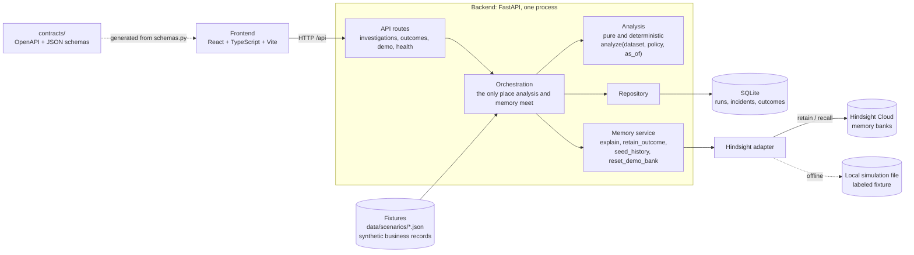

# IncentO

IncentO helps a Revenue Operations manager investigate whether an acquisition-based sales commission may be producing poor-fit deals. It links a commission policy to deals, support tickets and cancellations, calculates the evidence in code, and uses [Hindsight](https://hindsight.vectorize.io/) memory to remember past decisions and their measured results.

All data is synthetic. IncentO reports associations, never causes, and it never changes pay or policy on its own.

## The problem

A bonus for every new customer sounds sensible. It can also encourage heavy month-end discounting and deals that promise too much. The signals are scattered: sales has the deals, support has the complaints, finance sees the cancellations. Organizations also forget what they already tried and how it turned out.

## What it does

1. **Investigates a policy.** It compares month-end deals (closed in the last five UTC days of a month) with all other deals on three metrics: discount, complaints within 30 days, and cancellations within 30 days. Each metric shows group sizes, the gap with an uncertainty interval, and the gap before the policy started.
2. **Cites its sources.** Every claim links to a stored deal, ticket, cancellation or past incident. Customer text is labeled untrusted and shown as plain text.
3. **Remembers with Hindsight.** Past decisions, rejected hypotheses and measured results are recalled before the explanation is written. The same numbers can lead to different advice with and without memory: with memory off the advice is to revert the policy, and with a remembered failed revert it is to pilot a guardrail.
4. **Closes the loop.** A manager records a decision or a measured result. It is retained in Hindsight and recalled by the next investigation.

Rules that hold across the system:

- Numbers come only from deterministic analysis code. A language model never computes or overrides a metric.
- Every analysis and recall uses an `as_of` cutoff, so later events cannot leak into an earlier run.
- Observed facts, hypotheses, decisions and measured results stay distinct memory categories. A rejected hypothesis stays labeled rejected.
- If memory is unreachable the run still completes, and the screen shows memory as `unavailable`. A simulation or recording is labeled `fixture` and is never shown as `live`.
- Loads and outcome saves are idempotent, so a retry does not create duplicates.

## System architecture



| Layer | Responsibility |
|---|---|
| `frontend/` | Overview, Investigation, Compare memory and Incident timeline screens. Shows the data, memory and explanation labels on every page. |
| `backend/app/api/` | HTTP routes and error bodies (`{code, message, request_id, details}`). |
| `backend/app/core/` | Shared models (`schemas.py`), SQLite, fixture loading, guards, and `orchestration.py`, the only code that connects analysis and memory. |
| `backend/app/analysis/` | Cohort metrics, Wilson and Newcombe intervals, status rules and evidence corroboration. No HTTP, database or model calls. |
| `backend/app/memory/` | Hindsight integration. Recalls history, builds the explanation, retains outcomes, and validates the text. The Hindsight details stay inside `hindsight_adapter.py`. |
| `data/` | Seeded generator and the synthetic scenarios `risk`, `outage` and `sparse`. |
| `contracts/` | OpenAPI file and JSON schemas generated from `schemas.py`. The frontend types are generated from them. |

### One investigation

1. The frontend posts `{policy_id, scenario, as_of, memory_mode, idempotency_key}` to `/api/investigations`.
2. Orchestration loads the scenario fixture and calls `analyze`. It checks that every cited evidence ID is a real source record.
3. With memory on, `explain` recalls past incidents, decisions and results up to `as_of`. The explanation is a labeled template (`explanation_source: template`) that picks the most influential recalled record deterministically. Hindsight Reflect can write the text instead (`HINDSIGHT_REFLECT=1`), but it is off by default, and its output is validated against the no-causation and number rules, with the template as the fallback.
4. The run is saved in SQLite and returned with an `analysis_digest`. The digest is the same for memory off and on, which shows the numbers did not change.
5. `POST /api/incidents/{id}/outcomes` saves a decision or measured result and retains it in Hindsight. A failed retention keeps the outcome and offers a retry.

### Memory and the as-of rule

Hindsight banks are named `incento-demo-<scenario>` for the demo and `incento-dev-<scenario>` for development. A live run dated before the latest retained outcome is rejected with `409 as_of_before_memory`, so the run never shows an outcome that had not happened yet.

### Data

Each scenario is one JSON file with policies, customers, deals, tickets, cancellations and past incidents, all linked by stable IDs. `risk` has a flagged discount and complaint gap and a remembered failed revert. `outage` has a complaint spike on all deals that is not blamed on the bonus. `sparse` has too few month-end deals, so each metric reports insufficient data. Metrics are never inferred from display names, and money is stored as integer minor units.

### Tech stack

Python 3.12+ with FastAPI, pydantic v2 and SQLite on the backend. React 19, TypeScript and Vite on the frontend. Hindsight Cloud for memory.

## Further reading

Planning notes, API semantics, per-module notes, the demo script and the progress log are in [`references/`](references/).

## How to run it

Backend (needs Python 3.12+):

```bash
cd backend
uv venv --python 3.14 .venv
uv pip install --python .venv/bin/python -r requirements.txt
cp ../.env.example .env       # optional; put HINDSIGHT_API_KEY here for live memory
.venv/bin/python -m uvicorn app.main:create_app --factory --reload   # http://localhost:8000/api/health
```

Frontend (needs Node 20.19+ or 22.12+):

```bash
cd frontend
npm ci
npm run dev                   # http://localhost:5173, proxies /api to port 8000
```

Open the app and choose **Load and investigate**. With no key, set `HINDSIGHT_SIMULATE=1` for an offline run, which the header shows as `fixture`. Hindsight Cloud needs credits: when they run out, memory shows as `unavailable`.

Checks: `scripts/check.sh` runs lint, tests, the contract drift check and the frontend checks. See `references/demo-checklist.md` for the demo procedure.
