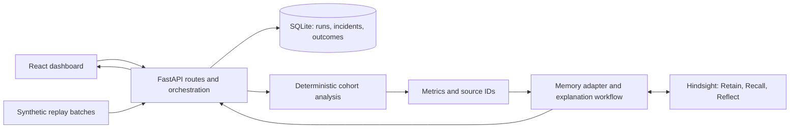

# IncentiveTrap Implementation Plan

## Goal and Current State

Build an eight-hour hackathon MVP with four people, each using their own coding assistant. Help a Revenue Operations manager investigate whether acquisition-based commissions may be encouraging poor-fit SaaS deals. Connect numerical signals, customer feedback, and remembered incidents without claiming causation.

Current state: the documentation baseline is committed and pushed; the local `reference/` folder is ignored. No application, dependencies, or tests exist yet. Everything below is a proposed implementation. Person labels P1-P4 are placeholders to assign at kickoff.

## Deliverable and Scope

The demo must let a user load synthetic business data, run an investigation, inspect evidence, see relevant past experience, record a management response, and recall that response in a later investigation.

Must ship:

- One company, one acquisition incentive, and a reproducible dataset with policies, deals, support tickets, and cancellations.
- A risk overview and investigation detail showing cohort sizes, metric changes, source records, alternatives, and recommended next steps.
- Actual Hindsight Retain, Recall, and Reflect integration, with persistence across application restarts.
- A second scenario involving a product outage, where evidence does not justify blaming incentives.
- An outcome form and a subsequent investigation demonstrating how saved experience changes the recommendation.

Defer live CRM integrations, authentication, multi-company access, streaming infrastructure, autonomous policy changes, employee rankings, and financial-loss forecasts. Simulate incoming data with explicit replay batches; describe this as a replay demo rather than production continuous monitoring.

## Architecture

Proposed stack: React + TypeScript + Vite frontend; Python + FastAPI backend; SQLite for run state (investigations, incidents, outcomes, and loaded batches); Hindsight for persistent qualitative memory. Use one backend process and simple synchronous investigation requests with bounded external-call timeouts. Choose and pin compatible runtime and dependency versions during bootstrap.



Validated fixture files hold the structured business records (policies, deals, tickets, cancellations), assembled from the loaded batches on each request. SQLite is the source of truth for run state: investigations, incidents, outcomes, retention status, and which batches are loaded (with a checksum). Hindsight stores policy context, incident narratives, hypotheses, decisions, and observed outcomes. Numerical results come from analysis code; generated explanations cannot replace calculated values.

### External services

- **Hindsight Cloud (decided).** One team account owned by P4; its LLM, embedding, and reranking models are included, so the application needs no LLM key. Self-hosting is not planned: it requires bringing your own LLM, and Groq's free tier (8,000 tokens per minute against roughly 64,000 for one retain call, per the Hindsight docs) is too small.
- **Banks.** Development banks are named `incento-<dev>-<scenario>`; demo banks are `incento-demo-<scenario>`. P4 confirms bank creation and isolation against the official documentation.
- **Explanations.** `explain()` calls Reflect with a `response_schema` (action, evidence-linked rationale, success metric, guardrail) and reads the `structured_output` field. P4 verifies at G2 that Reflect fills the agreed schema reliably and cites only retrieved memory IDs. If it cannot, record the failure and decide on a fallback with P2; do not add an application-side LLM silently. The Cloud model is not configurable by us (no temperature control), so reliability comes from the fixed `action_type` set and bank directives; see the demo reliability rules.
- **Secrets.** The only backend secrets are the Hindsight API URL and key (placeholder names `HINDSIGHT_API_URL` and `HINDSIGHT_API_KEY`, plus `HINDSIGHT_BANK_PREFIX`; P4 confirms them against the SDK). They go in `.env.example` as placeholders at bootstrap, are shared privately, never committed, and are revoked after the event.
- **Credits.** The Hindsight site offers $5 of sign-up credit and the reference PDF gives promo code `MEMHACK99` for $50, applied in the billing section after registering. Check the balance before each rehearsal and before the live demo.

Planned layout and exclusive ownership:

| Owner | Paths | Responsibilities |
| --- | --- | --- |
| P1: frontend | `frontend/**` | Screens, API client, UI types, component tests, frontend manifest and lockfile |
| P2: backend and integration lead | `backend/app/api/**`, `backend/app/core/**`, `backend/app/main.py`, `backend/app/__init__.py`, `backend/tests/integration/**`, `contracts/**`, `scripts/**` (except `scripts/demo_check.py`) | API, SQLite, orchestration, contracts, integration, release |
| P3: data and analysis | `backend/app/analysis/**`, `backend/tests/analysis/**`, `data/**` | Synthetic fixtures, cohort calculations, evidence extraction, analytical tests |
| P4: memory and explanations | `backend/app/memory/**`, `backend/tests/memory/**`, `docs/demo/**`, `scripts/demo_check.py` | Hindsight adapter, prompts, memory tests, demo script and recording checklist |

P2 alone owns remaining shared files: backend dependency/lock files, root configuration, `.gitignore`, `.env.example`, the top-level `README.md` (a thin index with the quick start and backend setup, linking to each owner's folder README), and these planning documents. `AGENTS.md` stays unchanged unless the user requests an update. Each person owns their own handoff file, `progress/p1.md` to `progress/p4.md`; P2 owns `progress.md` (shared status and the gate tracker).

P2 may create package boundary files during bootstrap; ownership transfers when the bootstrap commit is merged. After that, no cross-folder fixes without explicit coordination. Each person owns tests beside their own module; avoid a shared test utility file during this sprint.

## Planned File Structure

This is the target layout, not an inventory of existing code. Create files as their features are implemented; do not generate empty placeholders for the entire tree. Ownership labels apply to each directory's contents unless a child has a different owner.

```text
IncentO/
|-- AGENTS.md                         # Existing contributor guide; preserve
|-- implementation_plan.md            # Architecture, ownership, and schedule (P2)
|-- progress.md                       # Shared status and gate tracker (P2)
|-- progress/                         # One handoff file per person: p1.md-p4.md
|-- agent_help.md                     # Coding assistant workflow (P2)
|-- matka.md                          # Plain-language project explanation (P2)
|-- README.md                         # Quick start and backend setup; links to folder READMEs (P2)
|-- .gitignore                        # Local files and build exclusions (P2)
|-- .env.example                      # Backend configuration placeholders (P2)
|-- contracts/                        # P2; reviewed by all before freezing
|   |-- v1.md                         # API and internal module contracts
|   |-- openapi.json                  # Generated from the FastAPI app (P2)
|   |-- schemas/                      # Generated from core/schemas.py; do not edit
|   |   |-- dataset.schema.json       # Policies, deals, tickets, cancellations
|   |   |-- analysis.schema.json      # Cohorts, calculated metrics, evidence
|   |   |-- investigation.schema.json # API response and explanation fields
|   |   `-- outcome.schema.json       # Decisions and measured outcomes
|   `-- examples/
|       |-- investigation-request.json
|       |-- investigation-response.json
|       |-- outcome-request.json
|       `-- error-response.json
|-- frontend/                         # P1 owns this entire subtree
|   |-- README.md                     # Frontend setup and commands (P1)
|   |-- package.json
|   |-- package-lock.json
|   |-- index.html
|   |-- vite.config.ts
|   |-- tsconfig.json
|   |-- eslint.config.js
|   |-- public/                       # Static icons and demo assets
|   `-- src/
|       |-- main.tsx                  # Browser entry point
|       |-- App.tsx                   # Screen navigation and app shell
|       |-- api/client.ts             # Typed backend requests and errors
|       |-- types/contracts.ts        # Generated from contracts/openapi.json; do not edit
|       |-- pages/
|       |   |-- Overview.tsx          # Policy card, demo controls, and investigation list
|       |   |-- Investigation.tsx     # Finding, metrics, evidence, recommendation, Compare memory tab
|       |   `-- Incident.tsx          # Timeline across runs and the outcome form
|       |-- components/
|       |   |-- StatusBanner.tsx      # Synthetic data, memory status, explanation source
|       |   |-- MetricCard.tsx
|       |   |-- IntervalBar.tsx       # SVG interval bar; no chart library
|       |   |-- EvidenceList.tsx
|       |   |-- MemoryPanel.tsx
|       |   |-- MemoryCompare.tsx     # Without-memory versus with-memory view
|       |   |-- Timeline.tsx
|       |   `-- OutcomeForm.tsx
|       |-- styles/global.css
|       `-- tests/                    # Component and API-state tests
|-- backend/
|   |-- pyproject.toml                # Python/tool configuration (P2)
|   |-- requirements.txt              # Pinned backend dependencies (P2)
|   |-- app/
|   |   |-- __init__.py                # Package bootstrap (P2)
|   |   |-- main.py                    # FastAPI entry point (P2)
|   |   |-- api/                       # P2
|   |   |   |-- health.py
|   |   |   |-- demo.py
|   |   |   |-- policies.py
|   |   |   |-- investigations.py
|   |   |   `-- outcomes.py
|   |   |-- core/                      # P2
|   |   |   |-- config.py              # Environment loading and validation
|   |   |   |-- schemas.py             # Source of truth for contracts (shared typed models)
|   |   |   |-- database.py            # SQLite connection and run-state schema
|   |   |   |-- repository.py          # Run, incident, and outcome persistence; idempotency
|   |   |   |-- fixtures.py            # Validate fixture batches; assemble datasets from loaded batches
|   |   |   `-- orchestration.py       # Analyze, explain, and persist a run
|   |   |-- analysis/                  # P3
|   |   |   |-- service.py             # analyze() public module entry point
|   |   |   |-- cohorts.py             # Matching, maturity, and time filters
|   |   |   |-- metrics.py             # Rates, deltas, and uncertainty
|   |   |   `-- evidence.py            # Source linkage and corroboration
|   |   `-- memory/                    # P4
|   |       |-- README.md              # Hindsight setup, bank configuration, and tests (P4)
|   |       |-- service.py             # explain() and retain_outcome()
|   |       |-- hindsight_adapter.py   # Actual Hindsight SDK/API calls
|   |       |-- validation.py          # Output, citation, and chronology checks
|   |       `-- prompts/              # Explanation/reflection templates
|   `-- tests/
|       |-- integration/               # P2: complete API and persistence flow
|       |-- analysis/                  # P3: exact metrics and edge cases
|       `-- memory/                    # P4: adapter, output, and recall checks
|-- data/                             # P3; synthetic data only
|   |-- README.md                     # Field meanings and expected metrics
|   |-- generate/build_scenarios.py   # Seeded, deterministic fixture structure
|   |-- text/                         # Frozen surface text keyed by record ID (written once)
|   |-- scenarios/
|   |   |-- incentive-risk.json
|   |   |-- product-outage.json
|   |   `-- insufficient-data.json
|   `-- history/incidents.json        # Historical facts, decisions, outcomes
|-- docs/demo/                        # P4
|   |-- walkthrough.md                # Live demo and memory comparison
|   `-- submission-checklist.md       # Recording and individual deliverables
|-- scripts/                          # P2, except demo_check.py
|   |-- check.sh                      # Runs all frontend and backend checks and contract drift checks (P2)
|   |-- export_contracts.py           # Writes contracts/openapi.json and contracts/schemas/ (P2)
|   |-- smoke_test.py                 # Repeatable full-flow verification (P2)
|   `-- demo_check.py                 # Off/live repeat check and canary run (P4)
|-- reference/                        # Existing local PDF; ignored by Git
`-- .local/                           # Generated SQLite/runtime files; ignore
```

Add Python `__init__.py` files where package imports require them, under the same directory ownership. P2 owns shared models in `backend/app/core/schemas.py`, the single source of truth for contracts; P3 and P4 consume those models without editing them. Their modules must not import API routes, database access, or each other; P2 connects them through orchestration.

Keep contract examples small and stable for independent development. P3 owns synthetic historical records and coordinates their content with P4; P4 owns the logic that retains and recalls them. Frontend contract types are maintained by P1 against P2's frozen schemas.

Only synthetic fixtures and placeholder configuration belong in Git. Before scaffolding, P2 adds exclusions for `.env`, `.local/`, `.venv/`, Python caches, `node_modules/`, `dist/`, and local assistant workspace files, while retaining `.env.example`. The frontend gets only a non-secret API base URL; backend credentials remain server-side.

## Screens and UX Rules

P1 builds three screens against the contract examples. Value must be clear within the first minute, and memory is the centerpiece.

- **Overview.** Policy card, a "Run investigation" button, the list of past runs, and a compact demo-controls strip (load scenario, pick `as_of`, reset).
- **Investigation.** A headline finding with per-metric status chips; three metric cards (discount, early complaints, 30-day cancellations), each showing month-end versus other rates, sample sizes, the pre-policy gap, and an SVG interval bar (no chart library); a grouped evidence list with quotes in blocks labeled "customer text (untrusted)"; a recommendation card with the `action_type` chip, action, and rationale, whose metric tokens render as chips that highlight the matching metric card; success metric and guardrail labeled "proposed target (not calculated)"; an alternative-explanations panel; and a **Compare memory** tab.
- **Compare memory.** "Without memory" and "With memory" side by side, built from two runs of the same inputs with `memory_mode` `off` and `live` (no new endpoint). A "Same calculated numbers" badge appears when both `analysis_digest` values match; the changed `action_type` is highlighted; a "Because of" list shows the recalled memories behind the change (`history_influence`), labeled by type and date, with rejected hypotheses marked as rejected.
- **Incident.** A vertical timeline (run without memory, run with seeded history, decision saved, measured outcome, run again with the changed recommendation) showing each run's `action_type` and the memories it used, plus the outcome form with a retention chip (`pending`, `retained`, `failed`) and a Retry button.
- **Always visible.** "Synthetic data", memory status (`live`, `unavailable`, `fixture`), and explanation source; a `template` source reads "Template summary: the generated explanation failed validation".
- **Error and state mapping.** `as_of_before_memory` reads "Memory only moves forward. Run without memory, or reset the demo."; `retention_pending` disables re-run with "Saving outcome to memory…"; the common error shape (`code`, `message`, `request_id`) always shows a readable message and a retry where one applies.
- **Loading.** Investigations are one synchronous request, so show an indeterminate spinner with elapsed time and a timeout message. Do not show staged progress unless the backend streams real stages.
- **Rendering.** Plain text only (see the untrusted text rules); status never relies on color alone; type large enough to read in a 1080p recording.
- **Optional, cut first if behind.** A demo stepper on the Overview that mirrors the three-step walkthrough, and the metric-chip highlighting.

## Contracts to Freeze

P2 publishes `contracts/v1.md`, machine-readable schemas, and example requests/responses in two slices. P1/P3/P4 review each slice once, then build independently against its examples. These are internal application contracts, not assumed Hindsight SDK signatures.

- **Slice A (frozen at G1, 0:45).** The cross-module shapes P3 and P4 need to start: `AnalysisResult`, the `Explanation`/`Investigation` response, the error shape, and the ID, time, and money conventions, with one example each.
- **Slice B (frozen by G2, 2:00).** The dataset schema (finalized from P3's fixtures), the incident and outcome shapes, and the remaining examples.

Single source of truth (contracts are generated, not hand-copied):

- **Models.** P2's Pydantic models in `backend/app/core/schemas.py` are the only hand-written definition of the contract shapes. P3 and P4 import them without editing.
- **Generated artifacts.** `scripts/export_contracts.py` (P2) writes `contracts/openapi.json` from the FastAPI app and `contracts/schemas/*.json` from the models; both are committed so nobody needs a running server. P1's `npm run gen:types` runs openapi-typescript on `contracts/openapi.json` and writes `frontend/src/types/contracts.ts`. Generated files are never edited by hand.
- **Hand-written.** `contracts/v1.md` (semantics and conventions) and `contracts/examples/*.json`.
- **Drift guards in `scripts/check.sh`.** The export in check mode fails if the committed contract files differ from regenerated ones; every example must parse into its Pydantic model; the frontend regenerates its types and fails on any difference; `fixtures.py` validates fixture batches against the dataset model.
- **Freezing.** A slice is frozen at the commit that contains its regenerated artifacts; reviewers check the `contracts/openapi.json` diff to enforce additive-only changes.
- **Bootstrap risk.** Slice A needs stub routes with response models so the OpenAPI output contains the shapes. P1 verifies at bootstrap that openapi-typescript produces usable types from the Pydantic output.

Data rules:

- Stable string IDs: `policy_id`, `customer_id`, `deal_id`, `ticket_id`, `incident_id`, `run_id`. Tickets and cancellations reference a deal and customer; deals reference the applicable policy version.
- Record event timestamps and policy effective dates in UTC. Give each replay an `as_of` timestamp; exclude future events from calculations and memory retrieval.
- Store money as integer minor units plus currency, discounts as fractions from 0 to 1, and missing values explicitly. Do not join customers by display name.
- Define `Policy`, `Deal`, `Ticket`, `Cancellation`, `Incident`, and `ManagementOutcome` schemas. Deals include segment, acquisition channel, close time, and revenue; outcomes distinguish decisions from later measured results. Tickets and cancellations carry a `theme` from a fixed set (`missing_feature`, `onboarding_difficulty`, `pricing_dispute`, `outage`, `other`) assigned in the fixtures; code uses themes for counts and corroboration.
- Define `Evidence` with source ID, source type, timestamp, `theme`, excerpt where applicable (for display only; never sent to a model), and an exact record reference.
- Customers carry a stable ID, a fictional display name, industry, and region. Datasets carry `meta` with `synthetic: true`, a generator version, and a text version; the UI's "Synthetic data" badge is driven by it.
- Define `AnalysisResult` with cohort definitions/counts, metric denominators, deltas, the pre-policy baseline gap, uncertainty intervals, a per-metric `status` (`flagged`, `watch`, `no_signal`, or `insufficient_data`), evidence IDs, alternative explanations, and reasons for `insufficient_data`.
- Define `Investigation` with run/policy IDs, analysis, hypothesis, supporting and conflicting evidence, recommendations, recalled incident IDs, memory status (`live`, `unavailable`, or `fixture`), `explanation_source` (`reflect` or `template`), and non-secret validation error codes when an explanation failed validation.
- Every recommendation includes an `action_type` (a small fixed set), an action, a rationale linked to evidence, a proposed success metric, a guardrail, and `history_influence` (IDs of recalled memories that shaped it; empty when memory is off). Never invent citations or a numerical confidence score.

Entities and relationships:

- **Investigation.** One stored run of analysis plus explanation. Its ID is the `run_id`; there is no separate investigation ID. Each run records `memory_mode` and an `analysis_digest` (a hash of the calculated results, so two runs can be checked for identical numbers).
- **Incident.** The tracked case that persists across runs, with a deterministic ID, `inc-<policy_id>-<comparison_id>`, so a later investigation of the same policy finds the same incident and its saved outcomes. An investigation with insufficient data has `incident_id: null`. Seeded history incidents keep their own IDs from `data/history/incidents.json`.
- **Outcome.** Has an `outcome_id`, a `type` (`decision` or `measured_result`), the `incident_id`, the `run_id` it responds to, an `event_time` (so replays can exclude future outcomes), a client `idempotency_key`, and a `retention_status` (`pending`, `retained`, or `failed`, with a non-secret error reason).
- `memory_mode` is `live` (default) or `off`. `off` explains with no recalled history; P4 chooses the mechanism. Calculated results must be identical in both modes.

| API | Purpose |
| --- | --- |
| `GET /api/health` | App and memory configuration/status, without exposing secrets |
| `POST /api/demo/load` | Validate and register a named scenario/batch from the fixture files, idempotent by checksum (loading it twice is a no-op), and seed its historical incidents into memory (idempotent by incident ID); report a seed status |
| `POST /api/demo/reset` | Body `{scenario, confirm: true}`. Clear that scenario's runs, incidents, outcomes, and loaded-batch records from SQLite and delete and re-seed its demo memory bank. Refuses any bank without the `incento-demo-` prefix; works only when `DEMO_RESET_ENABLED=true` |
| `GET /api/policies` | List available policies and versions |
| `POST /api/investigations` | Accept policy, scenario, `as_of`, `memory_mode` (`live` or `off`), and idempotency key; create an investigation. The response includes `memory_mode`, `incident_id`, and `analysis_digest`. A `live` run with `as_of` earlier than the latest retained memory event returns `409 as_of_before_memory`; a `live` run on an incident with a `pending` outcome returns `409 retention_pending` |
| `GET /api/investigations` | List stored investigations |
| `GET /api/investigations/{id}` | Return complete investigation and evidence (`id` is the `run_id`) |
| `GET /api/incidents` | List tracked incidents |
| `GET /api/incidents/{id}` | Return the incident, its linked `run_id`s, and its outcomes with retention status |
| `POST /api/incidents/{id}/outcomes` | Save a decision or measured outcome and retain it in memory. The same `idempotency_key` returns the existing outcome with no duplicate; the same key with a different body returns `409 idempotency_conflict` |
| `POST /api/outcomes/{outcome_id}/retention` | Retry retaining a `failed` or `pending` outcome in Hindsight; no-op if already `retained` |

Agree on validation errors, empty responses, and a common error shape (`code`, `message`, `request_id`). Return partial analytical results if memory fails, clearly marked. Persist retention status; support retry without duplicating the management outcome.

Internal boundaries: P3 exports `analyze(dataset, policy_id, as_of) -> AnalysisResult`; P4 exports `explain(analysis, context) -> Explanation`, `retain_outcome(outcome) -> RetentionResult` (idempotent by `outcome_id`, so the retry endpoint simply calls it again), `seed_history(incidents) -> SeedResult`, and `reset_demo_bank(scenario) -> ResetResult`. The Hindsight docs list `delete_bank` and `clear_memories`; P4 confirms the exact SDK call before building reset. P2 handles loading, persistence, and serialization. P4 verifies actual Hindsight methods against the official documentation before implementation: <https://hindsight.vectorize.io/>.

## Phases and Eight-Hour Schedule

Elapsed times start at kickoff. The seven rows below are Phases 1-7, in order. Hold a five-minute check-in at each phase gate; report contract changes and blockers immediately. Time windows are targets, not permission to advance without passing a checkpoint.

| Time | P1: frontend | P2: API/integration | P3: analysis/data | P4: memory/demo | Exit gate |
| --- | --- | --- | --- | --- | --- |
| 0:00-0:45 | Sketch three screens; review examples | Bootstrap repo; freeze Slice A contracts and ownership | Define cohorts and fixture fields | Verify credentials; prove a real retain/recall call | Shared contracts and runnable skeleton |
| 0:45-2:00 | Build against local contract fixtures | Routes, SQLite, fixture loading, stub module wiring; freeze Slice B contracts | Generate scenarios and pure analysis functions | Adapter, reflection output, historical incident seed | Each module runs independently |
| 2:00-3:30 | Connect overview and evidence detail | Merge modules; wire complete investigation | Finish metrics and failure-case tests | Connect recalled evidence and recommendations | First real end-to-end investigation |
| 3:30-5:00 | Outcome form, memory panel, error states | Persistence, replay/idempotency, timeout handling | Outage control, sparse-data case, maturity checks | Save outcome; prove later recall after restart | Complete memory learning loop |
| 5:00-6:00 | UI usability and empty/loading states | Clean-checkout smoke test; resolve integration failures | Verify displayed numbers against fixtures | Validate citations, memory failure behavior, demo script | Feature freeze at hour 6 |
| 6:00-7:00 | Fix presentation blockers; capture screens | Rehearse launch; finish README/config instructions | Verify demo evidence; explain analytical limits | Record end-to-end demo and memory comparison | Reproducible release candidate |
| 7:00-8:00 | Personal submission materials and rehearsal | Final sequential merges, release checklist, submission | Personal submission materials and Q&A | Personal submission materials; final live rehearsal | Submission ready with buffer |

Every person prepares required personal content in Phases 6-7, after the skeleton works; none of it blocks earlier phases. The official content guide is already in `reference/`; its requirements are summarized in the Event Requirements and Release Checklist below. If content work needs more time, cut optional UI polish early.

### Gate Rules

- A phase is complete only when **every exit checkpoint below passes**. All implementation gates start as `NOT STARTED`; writing this plan does not complete them.
- The named owner supplies evidence. P2 and the relevant owner review it; another contributor reviews P2's own deliverables. Owners record their evidence (commands, results, run IDs, links) in their own `progress/pN.md`; P2 records the result, UTC time, reviewed commit, reviewers, and an evidence link in the `progress.md` tracker.
- Run integration checks against the merged `main` commit, not an unmerged personal branch. Include exact commands and outcomes, plus run IDs or screenshots for interactive checks. Screenshots alone do not prove calculations or persistent memory work.
- Start Phase N+1 only after Gate GN passes. While a gate is blocked, people may prepare independent fixtures, tests, or presentation material, but must not treat blocked functionality as accepted or build dependent integration on an unapproved contract.
- A failed checkpoint gets an owner, a concrete fix, and a retest time. Reduce optional scope to recover time; do not waive evidence integrity, live memory, or the outcome loop. Record scope changes before reassessment.
- Reopen a passed gate if a later change breaks its acceptance criteria. Recheck affected downstream gates before release. Feature freeze remains at elapsed hour 6 even if earlier gates run late; spend remaining time fixing the minimum demo.

### Phase 1 — Foundation and Contract Freeze (0:00-0:45)

**Objective:** Give all four people a stable starting point. **Coordinator:** P2. **Entry:** Planning documents available; kickoff begins.

Exit checkpoints — **G1**:

- [ ] **P2 + all:** Assign human owners, deadline, separate clones/worktrees, and file boundaries; verify each contributor's human Git identity and remote access.
- [ ] **P2:** Merge the skeleton and the Slice A contracts and examples (`AnalysisResult`, the `Explanation`/`Investigation` response, error shape, ID, time, and money conventions). All four contributors confirm field names and module signatures. Example payloads parse into the Pydantic models, and `scripts/check.sh` fails if the exported contracts or generated frontend types are stale.
- [ ] **P1/P2:** Frontend starts and renders its shell; backend starts and responds to `/api/health`; setup commands are recorded.
- [ ] **P4:** Create the team Hindsight Cloud account, apply the promo credit, and share the API key privately (never in Git). Retain a uniquely identified synthetic fact in a development bank and recall it in a separate request. Record the bank identifier and result without secrets. Also record which text-generation model Hindsight Cloud reports using (check the console and the Cloud docs at docs.hindsight.vectorize.io), or note that it is not visible.
- [ ] **P2 + all:** Add local configuration and runtime exclusions to Git before scaffolding grows. (Band AI desktop and content deliverables are deferred; see the Event Requirements and Release Checklist.)

**Advance when:** Shared interfaces are frozen and external memory access is proven. A simulated Hindsight response does not pass G1.

### Phase 2 — Independently Working Modules (0:45-2:00)

**Objective:** Complete each owned module against the same contracts. **Coordinator:** P2; each person owns their module evidence. **Entry:** G1 passed.

Exit checkpoints — **G2**:

- [ ] **P1:** The three screens (Overview, Investigation, Incident) render frozen contract fixtures, including a fixture pair for the Compare memory tab; loading, empty, and error states work; frontend build/type checks pass.
- [ ] **P2:** Policy listing, fixture loading, and investigation routes validate requests and return contract-valid responses. Loading the same batch twice is a no-op (same checksum); API tests pass with clearly labeled module stubs where needed. Slice B contracts (dataset schema, incident and outcome shapes) are frozen before this gate closes, and their example payloads parse into the Pydantic models.
- [ ] **P3:** Risk, outage, and sparse-data fixtures validate and use consistent source links (structure first; placeholder text is acceptable at this gate). The risk fixture meets the sizing minimums in Analysis and Memory Rules. Pure analysis returns expected counts/rates for a hand-calculated case; its unit tests pass.
- [ ] **P4:** Adapter performs actual Retain, Recall, and Reflect operations; Reflect is called with the agreed `response_schema`, and the returned `structured_output` is validated against the explanation contract with only retrieved memory IDs cited and numbers appearing only through metric tokens. Tests cover unavailable service and malformed output, distinguishing stubbed tests from live checks. The bank mission and directives are committed under `backend/app/memory/`.
- [ ] **P2 + owners:** Module PRs are reviewed and merged sequentially; contract compatibility checks pass on `main`; all four handoffs identify their commits and next tasks.

**Advance when:** Each module works independently and its interface is verified. Internal stubs allowed here must be removed from the live demo path at G3.

### Phase 3 — First Integrated Investigation (2:00-3:30)

**Objective:** Prove the core product works from the browser. **Coordinator:** P2; P1/P3/P4 verify their outputs. **Entry:** G2 passed.

Exit checkpoints — **G3**:

- [ ] **P1/P2:** From the UI, load the risk scenario, select a policy, run an investigation, and reopen its saved detail through the API without editing code or database rows.
- [ ] **P3:** Displayed values match fixture expectations, including cohort membership, denominators, observation dates, and source IDs; no future evidence appears. The hand-polished hero records for the walkthrough are in place.
- [ ] **P4:** The integrated request uses live Hindsight, recalls the seeded relevant incident, and returns an evidence-backed explanation with alternatives and a specific next action.
- [ ] **P1/P4:** Every displayed evidence reference resolves to a supplied record or retained incident; synthetic data and memory status are visible. No causal-certainty claim or invented citation appears.
- [ ] **P2:** Save a reproducible smoke-test result and run ID for the merged commit; freeze breaking contract changes.

**Advance when:** A real browser-to-analysis-to-memory investigation succeeds. A screenshot of fixture-only UI does not pass G3.

### Phase 4 — Persistent Learning Loop (3:30-5:00)

**Objective:** Demonstrate that remembered outcomes change later advice. **Coordinator:** P4, with P2 responsible for persistence. **Entry:** G3 passed.

Exit checkpoints — **G4**:

- [ ] **P1/P2/P4:** Submit a management decision and then a measured outcome through the UI/API. Both are stored distinctly, with confirmed memory retention status.
- [ ] **P2/P4:** Restart the application; verify the saved investigation and outcome remain accessible and a later investigation recalls the outcome from Hindsight.
- [ ] **P3/P4:** Compare the same current evidence with empty versus relevant history (`memory_mode` `off` versus `live`): numerical results stay identical, shown by equal `analysis_digest` values, while the explanation cites history and makes an identifiable, justified change to its recommendation: `action_type` differs and `history_influence` cites the retained record, in at least 4 of 5 repeated pairs (`scripts/demo_check.py --repeat 5`). The UI compare view shows both runs side by side with the "Same calculated numbers" badge and the changed action.
- [ ] **P2/P4:** Repeat outcome submission with the same idempotency key; no duplicate application event or duplicate logical memory record is created (retain uses `document_id` = `outcome_id`). A failed retention attempt is visible and succeeds on retry through `POST /api/outcomes/{outcome_id}/retention`.
- [ ] **P3/P4:** A run at an `as_of` earlier than a saved outcome excludes it from analysis; a `live` memory run at that `as_of` is rejected with `409 as_of_before_memory`. The canary test shows no future-dated record reaches recall or Reflect output; rejected past hypotheses remain labeled as rejected.

**Advance when:** Save, restart, recall, and changed advice are demonstrated on the merged commit. Merely storing text or promising future learning does not pass G4.

### Phase 5 — Correctness and Resilience (5:00-6:00)

**Objective:** Make the accepted demo reliable. **Coordinator:** P2; each owner fixes their module. **Entry:** G4 passed.

Exit checkpoints — **G5**:

- [ ] **P3:** Risk scenario is flagged with supporting evidence; outage scenario presents the alternative explanation without an incentive accusation; sparse data returns insufficient evidence. Duplicate, missing-link, zero-denominator, and immature-cohort tests pass. Generated text covers every record, or the remaining records use the labeled template text.
- [ ] **P4:** Missing credentials, timeout, malformed model output, invalid references, and stray numbers produce honest failure/partial-result states (a failed explanation falls back to the labeled template). Previously generated text is never silently presented as a fresh live result.
- [ ] **P1:** Loading, empty, error, and retry flows are usable; a user can inspect evidence and save an outcome without a broken screen.
- [ ] **P3/P4/P1:** The injection canary (`TICKET-INJECT-001`) leaves metrics, `analysis_digest`, and recommendation validity unchanged; a unit test shows no ticket text field reaches the prompt builder's output, and a UI test shows the string rendered as inert text.
- [ ] **P2 + a second contributor:** A clean checkout installs and runs using the README, with only documented external configuration. `scripts/check.sh` (frontend build/lint/tests, backend lint/tests, and contract drift checks) and the full-flow smoke check pass.
- [ ] **All:** No unresolved issue blocks launching, evidence inspection, correct metrics, or the live memory loop. Record deferred cosmetic issues, update handoffs, and freeze features.

**Advance when:** Required correctness checks pass and another person can reproduce the demo setup.

### Phase 6 — Release Candidate and Demo Rehearsal (6:00-7:00)

**Objective:** Turn the verified application into a clear presentation. **Coordinator:** P4; P2 owns the release candidate. **Entry:** G5 passed.

Exit checkpoints — **G6**:

- [ ] **P4 + all:** Rehearse the complete story: policy, warning, source evidence, prior memory, recorded outcome, and improved later recommendation, as a three-step progression (no memory, seeded history, after a recorded outcome). Show the business value within the first minute.
- [ ] **P2/P4:** Validate the demo's initial dataset and isolated memory state so a previous rehearsal cannot contaminate the comparison. Reset only designated demo state with `POST /api/demo/reset`; preserve saved evidence needed for the presentation.
- [ ] **P4:** Record a playable demo video from the release candidate and verify that the memory operations and outcome loop are visible. Label any fallback recording accurately. Save a known-good run snapshot (response JSON, run ID, screenshots) for the labeled fallback, and run the repeat check (`scripts/demo_check.py`) on the release candidate and again shortly before the live demonstration.
- [ ] **P2:** Record the release-candidate commit, launch instructions, test evidence, known limits, and recording location. Inspect commit attribution and tracked files for unintended local data or credentials.
- [ ] **All:** Draft the individual article and social post, plus the team video, required by the content guide; list remaining submission tasks with owners.

**Advance when:** The release candidate and presentation are reproducible, and the recording can be opened by another team member.

### Phase 7 — Final Submission and Handoff (7:00-8:00)

**Objective:** Deliver a complete, accessible submission. **Coordinator:** P2; every person owns their required content. **Entry:** G6 passed.

Exit checkpoints — **G7**:

- [ ] **P2:** Merge only reviewed release fixes. Rerun affected checks and the final full-flow smoke test on the exact submitted commit; record the final commit ID.
- [ ] **P2/P4:** Verify repository and video links are accessible as required by the event; have the documented launch procedure ready for the live demonstration.
- [ ] **All:** Complete required individual content and record its links/status against the official content guide.
- [ ] **P2:** Submit the required materials and save confirmation or receipt details; do not mark a merely prepared submission as delivered.
- [ ] **All:** Complete a final live rehearsal and update handoffs with outstanding limitations, release links, and recovery instructions.

**Complete when:** G1-G7 are all passed with evidence, the submitted commit is verified, and delivery is confirmed. If the deadline arrives with a failed gate, report the incomplete checkpoint explicitly rather than marking the project complete.

## Analysis and Memory Rules

P3 uses one predefined comparison design so the analysis cannot search for arbitrary coincidences:

- **Scope.** Only deals the policy applies to (the segment and channel in the policy record). Other segments appear as context only and are never searched for signals.
- **Groups.** Month-end deals (closed in the last five calendar days of a month, UTC) against all other deals, both on or after the policy effective date. The same split before the effective date gives a baseline gap.
- **Metrics (fixed at three).** Mean discount (fraction); early onboarding complaint rate within 30 days of close, counted by distinct customers; 30-day cancellation rate.
- **Maturity.** Complaint and cancellation rates use only deals with at least 30 days of observable history before `as_of`. Report excluded records and denominators.
- **Outage control.** A complaint spike across all deals in a time window does not widen the month-end gap, so it is not flagged as an incentive effect; the analysis reports the matching outage incident as the alternative explanation.

Decision rule per metric. These are transparent demo heuristics, not validated business thresholds or proof of statistical significance; make no causal claims.

| Status | Condition |
| --- | --- |
| `insufficient_data` | Fewer than 30 eligible deals in either group |
| `flagged` | The interval for the month-end gap has a lower bound above 0, the gap is at least 10 percentage points, and it exceeds the pre-policy gap by at least 10 percentage points |
| `watch` | The gap is at least 10 percentage points but one of the other two conditions fails; display as "cannot be distinguished from noise or a pre-existing pattern" |
| `no_signal` | Otherwise |

The investigation is flagged only if at least one metric is `flagged` and at least two distinct customers corroborate it with source records. Intervals: Wilson for each rate, Newcombe's hybrid-score interval for the difference between two rates, and a normal-approximation interval on the difference in means for discounts. Every result states that three metrics were checked. Sparse data returns an insufficient-evidence result.

Fixture sizing for P3: about 1,500 synthetic deals over nine months (three before the policy effective date, six after). The risk scenario has at least 60 month-end and 300 other eligible post-policy deals; at those sizes a 30% versus 15% gap has an interval above zero, while equal rates do not. The sparse-data scenario deliberately has fewer than 30 eligible month-end deals.

Realistic fixtures (the data must look real without ever affecting the calculations):

- **Stage 1: deterministic structure.** P3's seeded `data/generate/build_scenarios.py` produces the policy, customers, deals, tickets, cancellations, and incident records. All counts, rates, and timing come from scenario parameters (month-end clustering, planted cancellation rates, discount ranges, onboarding complaint timing), so the hand-calculated expected metrics in `data/README.md` are exact and testable. It also assigns each ticket a `theme` and a style (short and angry, polite, formal) so the text varies.
- **Stage 2: surface text, written once and frozen.** P3 uses their own coding assistant, not the application, to write fictional customer display names, ticket excerpts, cancellation reasons, incident narratives, and outage error logs, guided by a fixed fictional company profile and feature list so tickets are consistent. The output is committed as `data/text/*.json` keyed by record ID. Regenerating the structure never changes the text; regenerating text needs an explicit review of the diff.
- **Realism details.** Revenue in plausible SaaS ranges per segment (integer minor units); baseline discounts of about 5-15% with a month-end rush of about 20-35%; closes mostly on business days; tickets arriving 3-25 days after close; a mix of Indian and international fictional company names with industry and region; an outage scenario with a status-page style timeline and error log lines across all cohorts; past incidents written like short post-mortems.
- **Hero records.** About five to eight hand-polished deals and tickets for the walkthrough, reviewed by P3 and P4. `TICKET-INJECT-001` is hand-written.
- **Checks (P3 tests).** Every text ID maps to a structure record; length bounds; a cap on near-duplicate excerpts; no emails, phone numbers, or URLs; a manual scan that no real company or product names appear.
- **Timing.** Structure with placeholder text at G2, hero records by G3, full generated text by G5. If behind, keep the hero records and use plainly labeled template text for the rest.

Include early onboarding complaints as leading signals; later cancellations are follow-up evidence. Deduplicate tickets by source ID and avoid counting several tickets from one customer as independent corroboration. The outage scenario should produce a business-risk observation with an alternative explanation, not an incentive-specific accusation.

P4 retains facts, hypotheses, decisions, and measured outcomes as separate categories with timestamps and source IDs. Recall only context available by the run's `as_of` time. Seed one relevant prior incident and one rejected incentive hypothesis. Use a separate bank/namespace per developer and demo scenario to prevent cross-test contamination; P4 confirms the supported isolation mechanism.

Memory timeline rules (recall has no hard `as_of` filter, and observations blend facts from different times, so the guarantee comes from how memory is written and read):

- **One-way timeline.** Retain a record only when it becomes known: seed incidents are dated before the scenario starts, and outcomes are retained when saved, with `timestamp` set to their event time. A `live` run whose `as_of` is earlier than the latest retained event in that scenario's bank is rejected with `409 as_of_before_memory`; the UI offers `memory_mode` `off` or a demo reset. P2 derives the latest event time from SQLite. Analysis still works at any `as_of`.
- **Read-side filter.** Every retained item carries `timestamp` (event time), metadata, and tags for `record_type`, `incident_id`, and `source_ids`. Recall passes `query_timestamp = as_of` and drops any result dated after `as_of`. Memories cited by Reflect get the same check; if one is future-dated, reject the response and return a partial result with memory status `unavailable`.
- **Idempotent retain.** Retain with `document_id` set to the `outcome_id` (outcomes) or `incident_id` (seeded incidents); the same `document_id` replaces the old document and its memories instead of duplicating them.
- **Canary test.** P4 retains a future-dated synthetic record in a throwaway development bank, runs recall and Reflect at an earlier `as_of`, and confirms it never reaches a response. Label it a live test and record whether the server alone would have returned it.
- **Out of scope.** Memory rewind through per-`as_of` replay banks.

Explanation number rules (the model never types a number):

- **Tokens.** Text fields (summary, hypothesis, supporting and conflicting points, alternatives, rationale) refer to results with tokens such as `{{m:cancel_30d.gap}}`. Metric fields: both group rates, the gap, its interval bounds, both group sizes, the pre-policy gap, and the status. Plan thresholds have constant tokens such as `{{t:gap_threshold}}`. The prompt lists the valid token names for the run.
- **Validation.** Every token must resolve against the run's `AnalysisResult`; an unknown token rejects the response. After tokens are removed, those text fields may contain no digits, `%`, or "percent". Spelled-out numbers are a known, documented gap. `success_metric` and `guardrail` may contain digits as proposals; the UI labels them "proposed target (not calculated)".
- **Rendering.** P4 substitutes tokens. The response carries the resolved text for display and the tokenized template for audit.
- **Failure.** On a validation failure, retry Reflect once with the errors listed; if it fails again, return a deterministic explanation built by code from the analysis, with `explanation_source: template` and the non-secret validation error codes. Successful runs have `explanation_source: reflect`. The same rules apply when `memory_mode` is `off`.
- **Tests.** P4 covers an unknown token, a stray digit and `%`, correct token resolution, targets only in the two proposal fields, and the fallback path on malformed output; label them as stubbed tests, separate from live checks.

Demo reliability rules (the Cloud model behind Reflect is not configurable, so reliability comes from structure):

- **Bounded choice.** Each recommendation has an `action_type` from a small fixed set (`adjust_policy`, `pilot_guardrail`, `revert_change`, `collect_more_data`, `no_action`) and `history_influence`. Wording may vary; the action type may not.
- **Bank directives.** P4 writes and versions the bank mission and directives, for example: never repeat a recalled decision whose measured outcome was worse or showed no improvement, and cite it; label rejected hypotheses as rejected; use metric tokens, never digits.
- **Designed seeds.** P3 and P4 design the seeded history so that, for the risk scenario, `memory_mode` `off` yields one `action_type` and `live` yields a different one that cites the seeded record.
- **Repeat check.** `scripts/demo_check.py --repeat 5` (owned by P4) runs the off/live pair five times and asserts that `action_type` differs, `history_influence` cites the retained record, citations are valid, and no run fell back to the template. At least 4 of 5 pairs must pass. If it fails, adjust the directives or seed wording, not the demo script. Check the credit balance first.
- **No retention race.** `retention_status` stays `pending` until the retain operation completes (P4 confirms in the documentation how to await it). A `live` run on an incident with a pending outcome returns `409 retention_pending`, and the UI disables re-run until the outcome is `retained`.
- **Labeled fallback.** At G6, P4 saves a known-good run snapshot for use if live Hindsight fails during the demonstration. It is always labeled and never counted as live integration.
- **Learning curve.** The walkthrough shows three steps: no memory, seeded history, and after a recorded decision and measured outcome.

Untrusted text rules (customer-written text is the untrusted channel; policies, seeded incidents, and manager input are trusted but still bounded):

- **Allowlist for prompts.** P4's prompt builder serializes evidence with an allowlist, not a blocklist: only `id`, `source_type`, `timestamp`, and `theme`, plus metrics through tokens. `excerpt` and any other free text never reach a model. The explanation cites evidence IDs, and the UI resolves them to quotes.
- **Themes from fixtures.** P3 assigns each ticket and cancellation a `theme` from the fixed set. This is a demo simplification; production would use a constrained classifier.
- **Nothing raw in memory.** Retained content is built from templates containing IDs, themes, dates, and token references, never ticket or cancellation text. The manager's outcome note is capped at 280 characters, stripped of control characters and markup, and labeled as a manager note.
- **Output checks.** In addition to the explanation number rules, free-text fields are rejected if they contain URLs, markdown links, HTML, or code fences. `action_type` is a fixed set, and the application takes no autonomous actions.
- **Safe rendering.** The UI renders customer text and model text as plain text, with no `dangerouslySetInnerHTML`, shows quotes in blocks labeled "customer text (untrusted)", and uses only the structured explanation fields, never Reflect's free markdown.
- **Canary.** The risk fixture includes ticket `TICKET-INJECT-001` containing an injection string. Tests show that no ticket text field appears in the prompt builder's output, that metrics and `analysis_digest` are unchanged, and that the UI renders the string inert.

Demonstrate identical current evidence with an empty memory and with relevant history, then save a new outcome and show that it influences a later run. Keep calculations unchanged between comparisons. Verify returned references against stored evidence. Untrusted ticket text is data, never an instruction to the application (see the untrusted text rules). A stub or recording must be labeled; it cannot count as successful live Hindsight integration.

## Git Workflow and Conflict Prevention

1. P2 establishes a human Git author identity, makes the initial reviewed baseline commit, configures the team remote, and merges bootstrap contracts before others branch. Do not commit credentials, local databases, `reference/`, or assistant workspace files. Extend ignore rules before staging new tooling files.
2. Use separate clones or worktrees; never run four assistants in the same checkout. After the baseline exists, each person branches from current `main`:

   ```powershell
   git switch main
   git pull --ff-only origin main
   git switch -c feat/p1-frontend
   ```

   Use `feat/p2-api`, `feat/p3-analysis`, and `feat/p4-memory` for the other roles. Make small task branches from current `main` after each squash merge; do not continue an already squash-merged branch.
3. Stage explicit owned paths, inspect `git diff --cached`, then commit. Example subjects: `feat: add cohort evidence view`, `fix: handle missing policy dates`, `docs: update analysis handoff`. Commit subjects, bodies, and trailers must not mention coding assistants, agent names, model names, or generated-by/co-author bot attribution. Use the human contributor's identity. Inspect and remove automatically inserted attribution before committing.
4. P1 owns the frontend dependency manifest/lockfile; P2 owns backend dependencies. P3/P4 request dependency additions through P2. No whole-repository formatting, lockfile regeneration outside ownership, or unrelated cleanup.
5. Push feature branches and open focused PRs with changed behavior, validation commands/results, contract impact, and screenshots for visible UI changes. Owners may merge their own PRs that touch only their owned paths after `scripts/check.sh` passes and one other contributor approves; P2 merges anything touching contracts or shared files, and the gate integration commits. Merge one PR at a time; target merge gates at hours 2, 3.5, 5, and 6.
6. Before merging, fetch and merge current `origin/main` into the feature branch, rerun affected checks, and push. This avoids rewriting shared history. Resolve any conflict with its file owner; never blindly choose all of one side. Do not force-push `main`.
7. Each person keeps their handoff in their own file, `progress/pN.md`, and commits it with their feature branch. No merge slot is needed because nobody else edits it. P2 owns `progress.md` (shared status and the gate tracker). Do not rewrite or reformat another person's file.
8. Shared contract changes go through P2, who records the change and alerts all consumers. Contracts are generated: P2 edits `core/schemas.py`, runs `scripts/export_contracts.py`, and commits the regenerated files in the same PR; P1 then runs `npm run gen:types`. Slice A changes after hour 0:45 should be additive; Slice B may change until G2; no breaking changes to either after hour 3:30 without a team decision. Shared documentation edits also go through P2.

Exclusive path ownership prevents most code conflicts; the serialized merge queue handles shared files. Git cannot guarantee zero conflicts if these boundaries are ignored.

## Validation and Completion

P1 adds frontend `npm run dev`, `npm run build`, `npm run lint`, `npm test`, and `npm run gen:types` (openapi-typescript on `contracts/openapi.json`) scripts. P2 documents backend setup plus `python -m uvicorn app.main:app --reload`, `python -m pytest`, and `python -m ruff check .` from `backend/`. These are target commands, not currently runnable commands. P2 also provides `scripts/check.sh`, which runs all frontend and backend checks in one command (this replaces CI). Pin backend dependencies and keep secrets server-side; a browser-prefixed environment variable must never contain an API key.

- P1: build/type checks; evidence rendering, API error mapping, outcome-submission, and Compare memory UI checks.
- P3: exact fixture metrics; missing links; zero denominators; duplicate records; immature cohorts; future-data exclusion; outage and insufficient-data scenarios; generated-text checks (record ID mapping, length bounds, no emails, phone numbers, or URLs, and duplicate limits).
- P4: adapter tests for missing credentials, timeout, malformed output, invalid evidence references, and future-memory exclusion (including the live canary test); one real persistence/recall smoke test, separately labeled from mocked tests.
- P2: full load-investigate-outcome-reinvestigate flow; replay idempotency; persistence after restart; readable failure states; clean-checkout launch.

Done means a fresh checkout can run from documented commands, the UI shows traceable numerical and textual evidence, real memory affects a later recommendation, tests/checks have recorded outcomes, and the team can complete the live demo without editing code.

If behind: cut extra charts, styling, hosting, and extra scenarios beyond the required risk/control pair. Preserve source evidence, honest uncertainty, a working outcome loop, and real Hindsight integration. External service failure remains an explicit blocker, even if a labeled recording supports the presentation.

## Event Requirements and Release Checklist

The reference PDFs in `reference/` (the problem statement and the content guide; ignored by Git, so teammates need copies) require Hindsight, Band AI desktop use, a documented GitHub repository, a demo video, a live demonstration, an explanation of memory use, and content deliverables. Judging weights: innovation 30%, Hindsight memory 25%, implementation 20%, user experience 15%, real-world impact 10%.

Content deliverables are done in Phases 6-7, after the skeleton works, not at kickoff:

- **Each member:** one public article (1,200-1,500 words; the guide's contest table says 800-1,500 and its sample prompt says 1,200-2,000) on Medium, Dev.to/Hashnode, Substack, or as a LinkedIn article; one LinkedIn post that links the repository, with the article URL as the first comment and the Hindsight repository (<https://github.com/vectorize-io/hindsight>) as a second comment; and the article shared as a Reddit link post in r/llmdevs, r/sideproject, r/aiagents, or r/aimemory.
- **Team:** one video, 2-5 minutes, 1080p minimum, screen recording with voiceover, hosted on a public site rather than shared as a drive link. **Open question:** the problem statement says every member completes a video, while the content guide lists one per team; confirm with the organizers.
- **Banned word:** articles and social posts that contain the word "hackathon" in the title or body, hashtags included, are disqualified. As a precaution, keep it out of the README and the repository description as well. P4's `docs/demo/submission-checklist.md` includes a scrub check for every article and post.
- **Band AI desktop:** a required tool, but not set up at kickoff. After G3 passes and the skeleton works, use it for final polish and keep a screenshot or clip showing its use for the video.
- **Honesty:** articles describe only implemented behavior and label synthetic data. Ignore the guide's sample-prompt instruction to describe a future, fully implemented system.

Before release: verify human-only commit attribution, scan staged files for secrets, label synthetic data, check the README launch instructions, scan articles and posts for the banned word, save demo links, and update all four handoffs.
