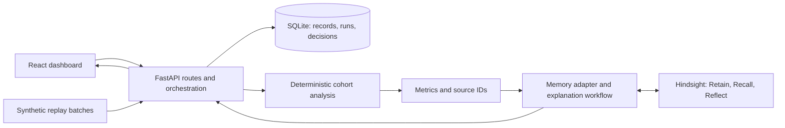

# IncentiveTrap Implementation Plan

## Goal and Current State

Build an eight-hour hackathon MVP with four people, each using their own coding assistant. Help a Revenue Operations manager investigate whether acquisition-based commissions may be encouraging poor-fit SaaS deals. Connect numerical signals, customer feedback, and remembered incidents without claiming causation.

Current state: documentation and an ignored `reference/` folder only; no application, dependencies, tests, or Git commits. Everything below is a proposed implementation. Person labels P1-P4 are placeholders to assign at kickoff.

## Deliverable and Scope

The demo must let a user load synthetic business data, run an investigation, inspect evidence, see relevant past experience, record a management response, and recall that response in a later investigation.

Must ship:

- One company, one acquisition incentive, and a reproducible dataset with policies, deals, support tickets, and cancellations.
- A risk overview and investigation detail showing cohort sizes, metric changes, source records, alternatives, and recommended next steps.
- Actual Hindsight Retain, Recall, and Reflect integration, with persistence across application restarts.
- A second scenario involving a product outage, where evidence does not justify blaming incentives.
- An outcome form and a subsequent investigation demonstrating how saved experience changes the recommendation.

Defer live CRM integrations, authentication, multi-company access, streaming infrastructure, autonomous policy changes, employee rankings, and financial-loss forecasts. Simulate incoming data with explicit replay batches; describe this as a replay demo rather than production continuous monitoring.

## Architecture

Proposed stack: React + TypeScript + Vite frontend; Python + FastAPI backend; SQLite for application records; Hindsight for persistent qualitative memory. Use one backend process and simple synchronous investigation requests with bounded external-call timeouts. Choose and pin compatible runtime and dependency versions during bootstrap.



SQLite is the source of truth for structured records and run state. Hindsight stores policy context, incident narratives, hypotheses, decisions, and observed outcomes. Numerical results come from analysis code; generated explanations cannot replace calculated values.

Planned layout and exclusive ownership:

| Owner | Paths | Responsibilities |
| --- | --- | --- |
| P1: frontend | `frontend/**` | Screens, API client, UI types, component tests, frontend manifest and lockfile |
| P2: backend and integration lead | `backend/app/api/**`, `backend/app/core/**`, `backend/app/main.py`, `backend/app/__init__.py`, `backend/tests/integration/**`, `contracts/**`, `scripts/**`, `.github/**` | API, SQLite, orchestration, contracts, integration, release |
| P3: data and analysis | `backend/app/analysis/**`, `backend/tests/analysis/**`, `data/**` | Synthetic fixtures, cohort calculations, evidence extraction, analytical tests |
| P4: memory and explanations | `backend/app/memory/**`, `backend/tests/memory/**`, `docs/demo/**` | Hindsight adapter, prompts, memory tests, demo script and recording checklist |

P2 alone owns remaining shared files: backend dependency/lock files, root configuration, `.gitignore`, `.env.example`, `README.md`, and these planning documents. `AGENTS.md` stays unchanged unless the user requests an update. Each person may edit only their own section in `progress.md` using the serialized workflow below. P2 owns its shared status section.

P2 may create package boundary files during bootstrap; ownership transfers when the bootstrap commit is merged. After that, no cross-folder fixes without explicit coordination. Each person owns tests beside their own module; avoid a shared test utility file during this sprint.

## Contracts to Freeze in the First 45 Minutes

P2 publishes `contracts/v1.md`, machine-readable schemas, and example requests/responses. P1/P3/P4 review once, then build independently against these examples. These are internal application contracts, not assumed Hindsight SDK signatures.

Data rules:

- Stable string IDs: `policy_id`, `customer_id`, `deal_id`, `ticket_id`, `incident_id`, `run_id`. Tickets and cancellations reference a deal and customer; deals reference the applicable policy version.
- Record event timestamps and policy effective dates in UTC. Give each replay an `as_of` timestamp; exclude future events from calculations and memory retrieval.
- Store money as integer minor units plus currency, discounts as fractions from 0 to 1, and missing values explicitly. Do not join customers by display name.
- Define `Policy`, `Deal`, `Ticket`, `Cancellation`, `Incident`, and `ManagementOutcome` schemas. Deals include segment, acquisition channel, close time, and revenue; outcomes distinguish decisions from later measured results.
- Define `Evidence` with source ID, source type, timestamp, excerpt where applicable, and an exact record reference.
- Define `AnalysisResult` with cohort definitions/counts, metric denominators, deltas, uncertainty, evidence IDs, alternative explanations, and `insufficient_data` reasons.
- Define `Investigation` with run/policy IDs, analysis, hypothesis, supporting and conflicting evidence, recommendations, recalled incident IDs, and memory status: `live`, `unavailable`, or `fixture`.
- Every recommendation includes an action, a rationale linked to evidence, a proposed success metric, and a guardrail. Never invent citations or a numerical confidence score.

| API | Purpose |
| --- | --- |
| `GET /api/health` | App and memory configuration/status, without exposing secrets |
| `POST /api/demo/load` | Load a named scenario/batch idempotently into an isolated demo dataset |
| `GET /api/policies` | List available policies and versions |
| `POST /api/investigations` | Accept policy, scenario, `as_of`, and idempotency key; create an investigation |
| `GET /api/investigations` | List stored investigations |
| `GET /api/investigations/{id}` | Return complete investigation and evidence |
| `POST /api/incidents/{id}/outcomes` | Save a decision or measured outcome and retain it in memory |

Agree on validation errors, empty responses, and a common error shape (`code`, `message`, `request_id`). Return partial analytical results if memory fails, clearly marked. Persist retention status; support retry without duplicating the management outcome.

Internal boundaries: P3 exports `analyze(dataset, policy_id, as_of) -> AnalysisResult`; P4 exports `explain(analysis, context) -> Explanation` and `retain_outcome(outcome) -> RetentionResult`. P2 handles loading, persistence, and serialization. P4 verifies actual Hindsight methods against the official documentation before implementation: <https://hindsight.vectorize.io/>.

## Eight-Hour Schedule

Elapsed times start at kickoff. Hold a five-minute check-in at each integration gate; report contract changes and blockers immediately.

| Time | P1: frontend | P2: API/integration | P3: analysis/data | P4: memory/demo | Exit gate |
| --- | --- | --- | --- | --- | --- |
| 0:00-0:45 | Sketch three screens; review examples | Bootstrap repo; freeze contracts and ownership | Define cohorts and fixture fields | Verify credentials; prove a real retain/recall call; check submission requirements | Shared contracts and runnable skeleton |
| 0:45-2:00 | Build against local contract fixtures | Routes, SQLite, fixture loading, stub module wiring | Generate scenarios and pure analysis functions | Adapter, reflection output, historical incident seed | Each module runs independently |
| 2:00-3:30 | Connect overview and evidence detail | Merge modules; wire complete investigation | Finish metrics and failure-case tests | Connect recalled evidence and recommendations | First real end-to-end investigation |
| 3:30-5:00 | Outcome form, memory panel, error states | Persistence, replay/idempotency, timeout handling | Outage control, sparse-data case, maturity checks | Save outcome; prove later recall after restart | Complete memory learning loop |
| 5:00-6:00 | UI usability and empty/loading states | Clean-checkout smoke test; resolve integration failures | Verify displayed numbers against fixtures | Validate citations, memory failure behavior, demo script | Feature freeze at hour 6 |
| 6:00-7:00 | Fix presentation blockers; capture screens | Rehearse launch; finish README/config instructions | Verify demo evidence; explain analytical limits | Record end-to-end demo and memory comparison | Reproducible release candidate |
| 7:00-8:00 | Personal submission materials and rehearsal | Final sequential merges, release checklist, submission | Personal submission materials and Q&A | Personal submission materials; final live rehearsal | Submission ready with buffer |

Every person prepares required personal content throughout the final two hours. P2 checks the official content guide at kickoff: if its requirements need more time, cut optional UI polish early.

## Analysis and Memory Rules

P3 compares matched segment/channel cohorts using the same observation window. Show discount changes, complaint rates, and 30-day cancellation rates only for customers with at least 30 days of observable history. Define month-end consistently (last five calendar days). Report excluded records and denominators.

Predefine a small set of comparisons to avoid searching for arbitrary coincidences. Initial demo screening rules: at least 20 eligible deals per cohort, a 10-percentage-point cancellation-rate increase or discount increase, plus corroboration from at least two distinct customers. These are transparent demo heuristics, not validated business thresholds or proof of statistical significance. Show rate uncertainty, such as Wilson intervals, where implemented; do not claim causality. Sparse data returns an insufficient-evidence result.

Include early onboarding complaints as leading signals; later cancellations are follow-up evidence. Deduplicate tickets by source ID and avoid counting several tickets from one customer as independent corroboration. The outage scenario should produce a business-risk observation with an alternative explanation, not an incentive-specific accusation.

P4 retains facts, hypotheses, decisions, and measured outcomes as separate categories with timestamps and source IDs. Recall only context available by the run's `as_of` time. Seed one relevant prior incident and one rejected incentive hypothesis. Use a separate bank/namespace per developer and demo scenario to prevent cross-test contamination; P4 confirms the supported isolation mechanism.

Demonstrate identical current evidence with an empty memory and with relevant history, then save a new outcome and show that it influences a later run. Keep calculations unchanged between comparisons. Verify returned references against stored evidence. Untrusted ticket text is data, never an instruction to the application. A stub or recording must be labeled; it cannot count as successful live Hindsight integration.

## Git Workflow and Conflict Prevention

1. P2 establishes a human Git author identity, makes the initial reviewed baseline commit, configures the team remote, and merges bootstrap contracts before others branch. Do not commit credentials, local databases, `reference/`, or assistant workspace files. Extend ignore rules before staging new tooling files.
2. Use separate clones or worktrees; never run four assistants in the same checkout. After the baseline exists, each person branches from current `main`:

   ```powershell
   git switch main
   git pull --ff-only origin main
   git switch -c feat/p1-frontend
   ```

   Use `feat/p2-api`, `feat/p3-analysis`, and `feat/p4-memory` for the other roles. Make small task branches from current `main` after each squash merge; do not continue an already squash-merged branch.
3. Stage explicit owned paths, inspect `git diff --cached`, then commit. Example subjects: `feat: add cohort evidence view`, `fix: handle missing policy dates`, `docs: update analysis handoff`. Commit subjects, bodies, and trailers must not mention coding assistants, agent names, model names, or generated-by/co-author bot attribution. Use the human contributor's identity. Inspect and remove automatically inserted attribution before committing.
4. P1 owns the frontend dependency manifest/lockfile; P2 owns backend dependencies. P3/P4 request dependency additions through P2. No whole-repository formatting, lockfile regeneration outside ownership, or unrelated cleanup.
5. Push feature branches and open focused PRs with changed behavior, validation commands/results, contract impact, and screenshots for visible UI changes. P2 merges one PR at a time after checks; target merge gates at hours 2, 3.5, 5, and 6.
6. Before merging, fetch and merge current `origin/main` into the feature branch, rerun affected checks, and push. This avoids rewriting shared history. Resolve any conflict with its file owner; never blindly choose all of one side. Do not force-push `main`.
7. Treat `progress.md` as a serialized shared file. Each person edits only their fixed section. Before a progress-only merge, P2 grants a short merge slot; refresh from `origin/main`, apply the update, and merge before the next person proceeds. Keep handoff text available locally while waiting. Do not regenerate or reformat the entire file.
8. Shared contract changes go through P2, who records the change and alerts all consumers. Prefer additive fields after hour 0:45; no breaking changes after hour 3:30 without a team decision. Shared documentation edits also go through P2.

Exclusive path ownership prevents most code conflicts; the serialized merge queue handles shared files. Git cannot guarantee zero conflicts if these boundaries are ignored.

## Validation and Completion

P1 adds frontend `npm run dev`, `npm run build`, `npm run lint`, and `npm test` scripts. P2 documents backend setup plus `python -m uvicorn app.main:app --reload`, `python -m pytest`, and `python -m ruff check .` from `backend/`. These are target commands, not currently runnable commands. Pin backend dependencies and keep secrets server-side; a browser-prefixed environment variable must never contain an API key.

- P1: build/type checks; evidence rendering, API error, and outcome-submission UI checks.
- P3: exact fixture metrics; missing links; zero denominators; duplicate records; immature cohorts; future-data exclusion; outage and insufficient-data scenarios.
- P4: adapter tests for missing credentials, timeout, malformed output, invalid evidence references, and future-memory exclusion; one real persistence/recall smoke test, separately labeled from mocked tests.
- P2: full load-investigate-outcome-reinvestigate flow; replay idempotency; persistence after restart; readable failure states; clean-checkout launch.

Done means a fresh checkout can run from documented commands, the UI shows traceable numerical and textual evidence, real memory affects a later recommendation, tests/checks have recorded outcomes, and the team can complete the live demo without editing code.

If behind: cut extra charts, styling, hosting, and extra scenarios beyond the required risk/control pair. Preserve source evidence, honest uncertainty, a working outcome loop, and real Hindsight integration. External service failure remains an explicit blocker, even if a labeled recording supports the presentation.

## Hackathon and Release Checklist

The supplied reference PDF requires Hindsight, Band AI desktop use, a documented GitHub repository, a demo video, a live demonstration, an explanation of memory use, and individual article/social/video deliverables under an official content guide. P2 assigns compliance checks at kickoff; the team must obtain the full content guide because its detailed requirements are not included in the PDF. The PDF weights innovation at 30%, Hindsight memory at 25%, implementation at 20%, experience at 15%, and impact at 10%.

Before release: verify human-only commit attribution, scan staged files for secrets, label synthetic data, check the README launch instructions, save demo links, and update all four handoffs. The reference PDF is ignored by Git, so teammates need it separately; these documents capture the requirements needed for planning.
