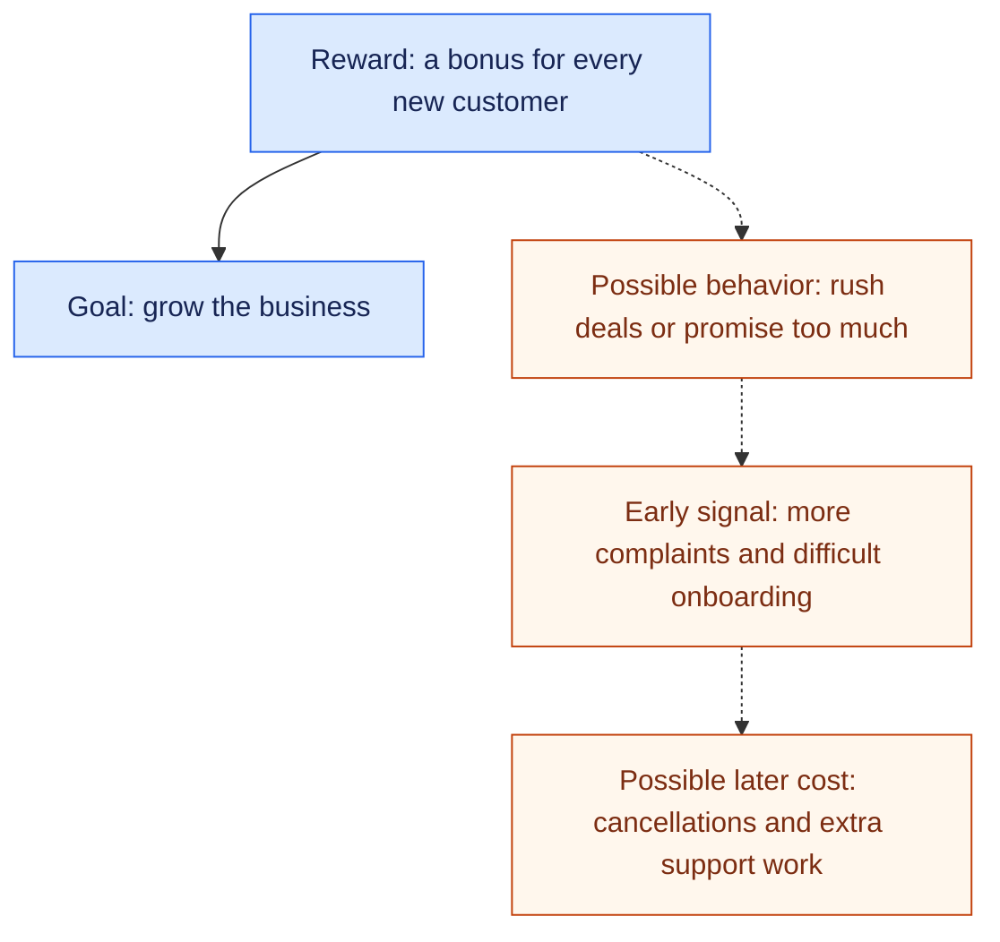
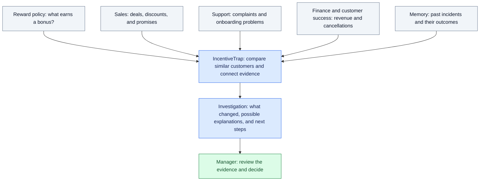
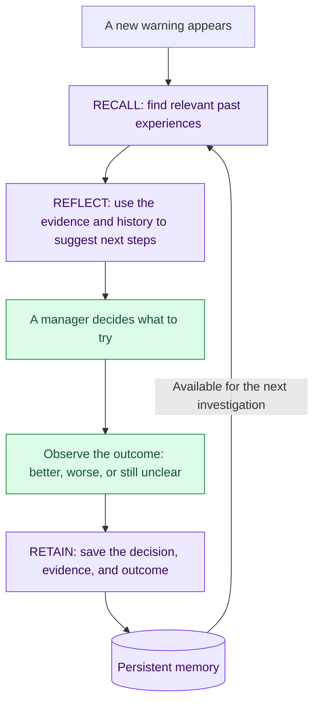

# IncentiveTrap, Explained Simply

## The Problem

Imagine a software company gives salespeople a bonus for every new customer they sign up.

That sounds sensible: more customers should mean more business. But the reward may encourage some salespeople to close deals with customers who are a poor fit, offer large discounts, or promise features the product does not have.

Sales numbers look good at first. Later, customers complain, support teams get busier, and some customers leave. The company may be paying bonuses for sales that create problems elsewhere.

The clues are scattered. Sales has the deal details. Support has the complaints. Finance sees the money. Someone needs to connect those clues.

### How a Good Intention Can Go Wrong

This is a possible chain of events to investigate, not proof that a reward caused a problem. Dashed arrows show suspected connections.

## What IncentiveTrap Does

IncentiveTrap is an early-warning assistant for the people managing sales and business performance. It looks for cases where a reward may be encouraging behavior that hurts the company's broader goals.

It helps answer:

- What changed after this reward policy started?
- Which groups of customers are affected?
- What do their complaints and cancellation reasons say?
- Have we seen something similar before?
- What should we investigate or try next?

### Connecting the Clues

The assistant brings separate pieces of information into one investigation. A person reviews the evidence and chooses what to do.

## A Simple Example

Suppose a company starts rewarding the number of new customers acquired. In our fictional demo, more deals close near the end of the month. Those customers receive bigger discounts, and several report that promised features are missing.

IncentiveTrap links the deals and complaints, calculates how common the pattern is, and shows the original evidence.

It might say: "These customers are reporting more problems. The commission policy could be one explanation. Review the sales promises and compare similar customers before changing the policy."

It must also consider other explanations. If a product outage caused the complaints, blaming the reward policy would be misleading.

## Why Memory Matters

Hindsight is the system's persistent memory. Think of it as a notebook that the assistant can search and learn from:

- **Retain:** Write down an incident, the evidence, what management decided, and what happened afterward.
- **Recall:** Find relevant past experiences when a new problem appears.
- **Reflect:** Use those experiences to explain the current situation and suggest a more informed next step.

For example, if a previous team tried an intervention that failed, the assistant should remember that result and explain why repeating it may be unhelpful. Saved suspicions remain suspicions until stronger evidence supports them.

### How Experience Helps the Next Investigation

The loop includes what actually happened after a decision. Saving a recommendation alone does not show whether it worked.

## What We Are Building in Eight Hours

Our prototype will use clearly labeled fictional business data. A user will run an investigation, inspect the evidence, see relevant memories, and record a response. A later investigation will show that the system remembers that response.

Four people will build the screens, backend, analysis, and memory integration. New data will arrive through a demo replay rather than connections to real company systems.

The system provides evidence and suggestions. People decide what to investigate and whether to change a policy. The prototype will not prove that incentives caused a problem or claim that it has already saved money.

## Who It Helps

Sales leaders, Revenue Operations teams, and Finance teams can use it to spot potential problems earlier and avoid repeating decisions that did not work.

**The pitch:** IncentiveTrap helps companies notice when their rewards may be encouraging the wrong results, and remembers what happened last time so they can make better decisions.
